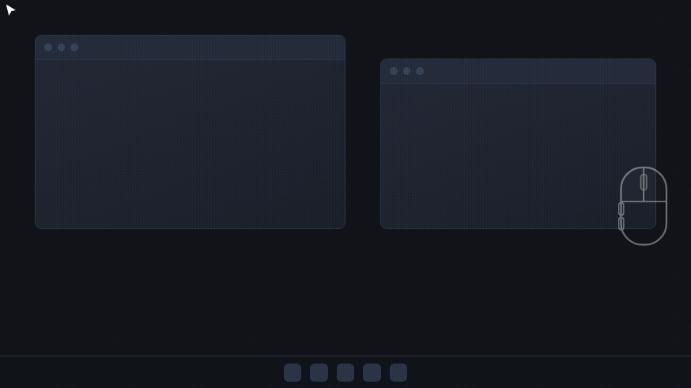
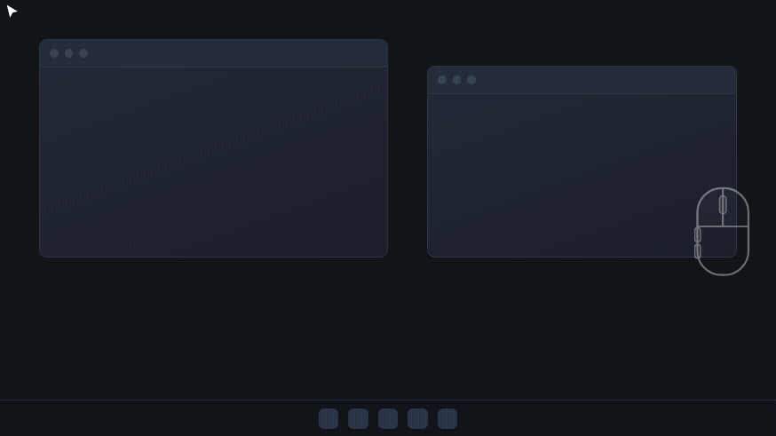
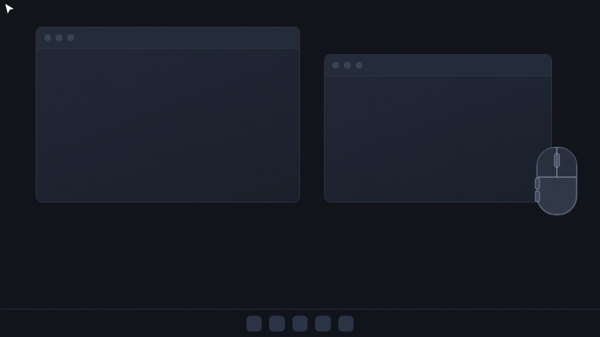

<h1 align="center">KeySplera</h1>

  <strong>Show every keystroke and click, right on screen.</strong> 
  Keycaps · Wireframe keyboard &amp; mouse · Click ripples · Wheel capsule · Click-through overlay

  A Windows overlay for recordings, tutorials and demos — 
  your input, drawn on screen in real time.

  
  

  <strong><a href="README.md">English</a></strong> ·
  <a href="README.zh-CN.md">简体中文</a>

 

<strong>🧭 Quick navigation</strong>

| What it does | Learn more | Get started |
| --- | --- | --- |
| [Core capabilities](#core-capabilities): Keycaps · Wireframe keyboard · Wireframe mouse · Click ripples & wheel capsule · Transparent overlay · Settings & tray | [Built for the work behind every recording](#built-for-the-work-behind-every-recording) [FAQ](#faq) [Known limitations](#known-limitations) | [Requirements](#requirements) [Support and feedback](#support-and-feedback) |

> **How it works:** ① run it — it sits in the tray → ② type and click as usual → ③ every action is drawn on screen, and any recorder captures it.

<figure>
  
  
<strong>KeySplera at a glance.</strong> Keycaps, wireframe mouse and ripples — every input, drawn in sync.

</figure>

 

## Built for the work behind every recording

A recording shows the result but hides the input: which key, which button, where the cursor was. KeySplera paints that back on, so viewers follow along without pausing or guessing.

- **Nothing to edit:** any recorder captures the overlay as-is — no post-production
- **Nothing to change:** type and click as usual; it follows in real time
- **Tune each piece:** every element has its own size, opacity and visibility — keep what helps your audience

Common uses: tutorials, product demos, walkthroughs, lessons.

 

## Core capabilities

### ⌨️ Keycap overlay · Every press, release and repeat

Press, and the keycap sinks; release, and it bounces back and fades.

- Held keys and fast re-presses tick a red **×N** badge — nothing gets lost
- Combos (like **Ctrl + Shift + S**) sit side by side
- Size, opacity and letter case are adjustable

**In detail:** modifier keys are normalized to `Ctrl` / `Shift` / `Alt` / `Win`; the keycap queue can be hidden and repositioned per screen.

<figure>
  
  
<strong>Keycap states.</strong> Press sinks, release bounces back, repeats count up in the corner.

</figure>

### 🗺️ Wireframe keyboard · The layout, lit as you type

A top-down wireframe of a US keyboard, lit key by key.

- Five layouts to match your keyboard: **104 / 87 TKL / 75 / 68 (65%) / 61 (60%)**
- Pressed keys light up with a ripple; compact layouts include an `Fn` key
- A frosted translucent backplate keeps it readable on light wallpapers
- Size, opacity, visibility and position are independent

**In detail:** `Fn` is handled by the keyboard firmware and never reaches the system — drawn, but never lit.

### 🖱️ Wireframe mouse · Which button, exactly

The mouse figure idles faintly and lights the exact part on every click.

- Left **blue** · right **red** · middle **amber** · side buttons **purple**
- Same wireframe language as the keyboard diagram
- Size, opacity, visibility and screen position are adjustable

**In detail:** the figure brightens for the press, then settles back to idle.

<figure>
  
  
<strong>Wireframe mouse.</strong> Each click lights its own part — and ripples where it happened.

</figure>

<figure>
  
  
<strong>Mouse style B — solid.</strong> A filled dark body, more prominent than A — same per-button highlight and ripples.

</figure>

### 💧 Click ripples & wheel capsule · Where the cursor landed

- Clicks bloom a double-ring ripple in the button's color — viewers see *where*, not just *what*
- Scrolling flashes a dark glass capsule with streaming direction chevrons; continuous scrolling merges into one cue
- Ripple size is adjustable

**In detail:** drawn on the same overlay as everything else — nothing extra to run.

### 🖥️ Transparent overlay · On top of everything, in the way of nothing

- Spans the whole virtual desktop — multi-monitor union, negative coordinates included
- Always on top, click-through, never stealing focus — input lands in the app underneath
- No taskbar button, no window frame — it is there to be seen, not used
- Any screen recorder captures it — no second pass

### 🧰 Settings & tray · Set it once, it remembers

Tuned from the tray → **Settings…**, with sliders that apply live and are remembered.

- Keycaps: size, opacity, letter case
- Wireframe keyboard: size, opacity, show / hide, screen and position
- Wireframe mouse: size, opacity, show / hide, screen and position
- Ripples: size
- The settings window remembers its position and size; the tray menu (English / 简体中文) has Settings / Show / Hide / Quit

 

## FAQ

**Will it slow down my typing or clicking?**
No. The hook only reads each event and forwards it — nothing blocks your input.

**Does the overlay steal clicks or focus?**
No. It is click-through and never takes focus — everything reaches the app underneath.

**Does it show up in my recording?**
Yes — it is part of the picture, so any recorder captures it as you see it.

**Multiple monitors?**
Yes — it spans the virtual desktop, and each element can target a specific screen.

 

## Known limitations

- **Elevated windows:** input inside admin-elevated windows is not captured unless KeySplera runs as administrator (Windows rule).
- **Mixed display scaling:** ripples convert with the primary display's scale factor and may be slightly off.
- **White line art:** the wireframe keyboard and mouse read best over dark windows and wallpapers.
- Windows only, for now.

 

## Keywords

KeySplera; Mosuzo Studio; keystroke overlay; keyboard and mouse overlay; click ripples; wheel indicator; screen recording overlay; Windows

 

## Requirements

> **Windows 10 / 11 (64-bit).** In early development — no public build yet; watch [Releases](https://github.com/mosuzo-studio/KeySplera/releases) for it. Feedback is welcome today.

 

## Support and feedback

Questions, ideas and feedback are welcome.

  
  

 

---

  <strong>Mosuzo Studio</strong> · © 2026 All rights reserved 
  <strong>Key</strong> + <strong>Splash</strong> + <strong>era</strong> — every press splashes a little feedback onto the screen · Kee-SPLEH-ra (/kiːˈsplɛrə/)

  <a href="https://github.com/mosuzo-studio/KeySplera">GitHub</a> ·
  <a href="https://github.com/mosuzo-studio/KeySplera/issues">Feedback</a> ·
  <a href="mailto:mosuzo.studio@gmail.com">Email</a>

