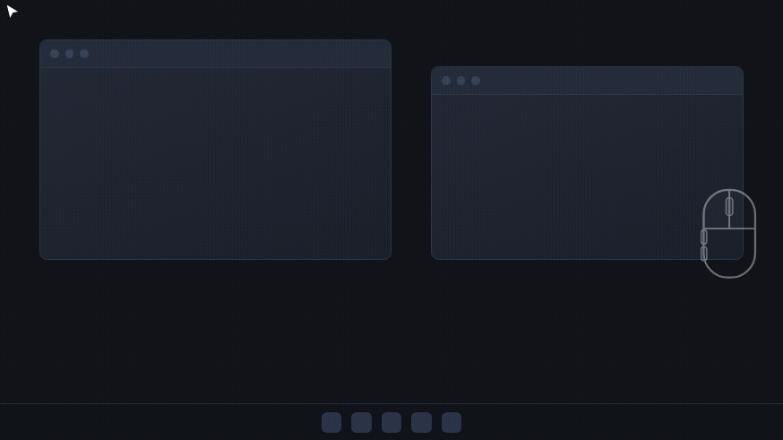
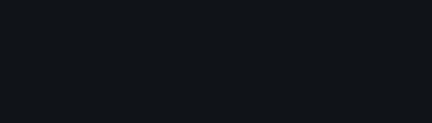
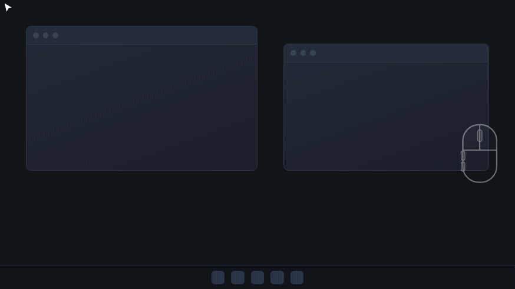
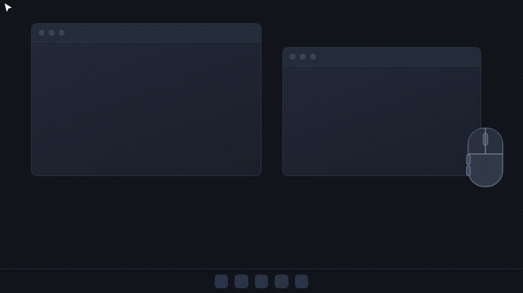

<h1 align="center">KeySplera</h1>

  <strong>把每一次按键和点击，实时画在屏幕上。</strong> 
  键帽 · 线框键盘与鼠标 · 点击涟漪 · 滚轮胶囊 · 点击穿透覆盖层

  为录屏、教学与演示而生的 Windows 覆盖层 —— 
  你的输入，实时呈现在屏幕上。

  
  

  <a href="README.md">English</a> ·
  <strong><a href="README.zh-CN.md">简体中文</a></strong>

 

<strong>🧭 快速导航</strong>

| 主要功能 | 了解更多 | 开始使用 |
| --- | --- | --- |
| [核心能力](#核心能力)：键帽 · 线框键盘 · 线框鼠标 · 点击涟漪与滚轮胶囊 · 透明覆盖层 · 设置与托盘 | [为每段录屏背后的工作而生](#为每段录屏背后的工作而生) [常见问题](#常见问题) [已知限制](#已知限制) | [运行要求](#运行要求) [支持与反馈](#支持与反馈) |

> **三步上手：** ① 运行它 —— 待在托盘里即可 → ② 照常打字、点击 → ③ 每个操作实时画在屏幕上，录屏自然带上。

<figure>
  
  
<strong>KeySplera 一览。</strong> 键帽、线框鼠标与涟漪 —— 每一次输入都同步画在桌面最上层。

</figure>

 

## 为每段录屏背后的工作而生

录屏能看到结果，却看不到输入：按了哪个键、点了哪个按钮、光标在哪。KeySplera 把这些画回屏幕上，观众不用暂停或猜测就能跟上。

- **不用后期：** 录屏软件按原样一并录下 —— 无需后期合成
- **不用改变习惯：** 照常打字、点击，实时跟随
- **每个部件都能调：** 键帽、键盘图、鼠标图与涟漪各有大小、不透明度与显隐 —— 只留对你有用的

常见用途：编程教学、产品演示、售后讲解、课程分享。

 

## 核心能力

### ⌨️ 键帽 · 每一次按下、松开与重复

按下，键帽下沉；松开，回弹淡出。

- 按住与快速连点，右上角红色 **×N** 即时累加 —— 一次不漏
- 组合键（如 **Ctrl + Shift + S**）并排显示
- 大小、不透明度与字母大小写可调

**详解：** 修饰键统一为 `Ctrl` / `Shift` / `Alt` / `Win`；键帽队列可隐藏、可按屏幕调位。

<figure>
  
  
<strong>键帽三态。</strong> 按下下沉、松开回弹，重复次数在角标累加。

</figure>

### 🗺️ 线框键盘 · 配列全图，打字即亮

**美式配列**俯视线框键盘图，按键即亮。

- 五种配列可选：**104 全尺寸 / 87 TKL / 75 / 68（65%）/ 61（60%）**
- 按下的键高亮并泛涟漪；紧凑配列带 `Fn` 键
- 透明磨砂底，浅色壁纸也清晰
- 大小、不透明度、显隐与位置独立设置

**详解：** `Fn` 由键盘固件处理、系统收不到事件，因此会画出但不参与高亮。

### 🖱️ 线框鼠标 · 哪个键，一目了然

鼠标图形淡显常驻，每次操作点亮对应部件。

- 左键 **蓝** · 右键 **红** · 中键 **琥珀** · 侧键 **紫**
- 与线框键盘图同一套线稿语言
- 大小、不透明度、显隐与所在屏幕均可调

**详解：** 图形只在操作瞬间亮起，随即回到常驻淡显。

<figure>
  
  
<strong>线框鼠标。</strong> 每个键点亮自己的部件 —— 点击处同时荡开涟漪。

</figure>

<figure>
  
  
<strong>鼠标款 B · 拟物。</strong> 深色实底、比 A 更醒目 —— 按键高亮与涟漪逻辑一致。

</figure>

### 💧 点击涟漪与滚轮胶囊 · 光标落在哪里

- 点击在光标处荡开双环涟漪、按色区分 —— 既看清做了什么，也看清在哪
- 滚轮闪出深色玻璃胶囊，方向箭头流动；连续滚动合并成一条、不叠层
- 涟漪大小可调

**详解：** 与其余元素画在同一层覆盖层 —— 没有额外进程。

### 🖥️ 透明覆盖层 · 置顶，却不挡任何操作

- 铺满整个虚拟桌面 —— 多屏并集，含负坐标副屏
- 置顶、**点击穿透**、不抢焦点：输入照常落到底下的应用
- 没有任务栏按钮、没有窗口边框 —— 只负责被看到，不负责被使用
- 录屏天然包含它 —— 无需二次合成

### 🧰 设置与托盘 · 调一次，一直记住

所有观感都在托盘 → **设置…** 里调，滑杆实时生效并记住。

- 键帽：大小、不透明度、字母大小写
- 线框键盘图：大小、不透明度、显隐、屏幕与位置
- 线框鼠标图：大小、不透明度、显隐、屏幕与位置
- 涟漪：大小
- 设置窗口记住自己的位置与大小；托盘菜单随系统语言（English / 简体中文）：设置 / 显示 / 隐藏 / 退出

 

## 常见问题

**会拖慢打字或点击吗？**
不会。钩子只读事件并转发 —— 不阻塞输入。

**覆盖层会抢点击或焦点吗？**
不会。点击穿透、不抢焦点 —— 操作照常落到下面的应用。

**录屏里会录到吗？**
会 —— 它就是画面的一部分，录屏所见即所得。

**多显示器呢？**
支持 —— 覆盖整个虚拟桌面，每个元素可指定屏幕。

 

## 已知限制

- **管理员（高完整性级）窗口：** 非提权进程的钩子收不到这些窗口的输入，需以管理员身份运行（Windows 权限模型）。
- **多屏不同缩放：** 涟漪按主屏缩放因子换算，可能有细微偏差。
- **白色线稿：** 线框键盘与鼠标在深色窗口、壁纸上最清晰。
- 目前仅支持 Windows。

 

## 关键词

KeySplera；Mosuzo Studio；键鼠操作可视化；键帽；按键显示；点击涟漪；录屏覆盖层；Windows

 

## 运行要求

> **Windows 10 / 11（64 位）。** 早期开发中 —— 尚无公开构建，关注 [Releases](https://github.com/mosuzo-studio/KeySplera/releases)；欢迎反馈。

 

## 支持与反馈

有问题或想法，欢迎告诉我们。

  
  

 

---

  <strong>Mosuzo Studio</strong> · © 2026 保留所有权利 
  <strong>Key</strong> + <strong>Splash</strong> + <strong>era</strong> —— 每敲一下，都溅起一点看得见的反馈 · 读作 Kee-SPLEH-ra（/kiːˈsplɛrə/）

  <a href="https://github.com/mosuzo-studio/KeySplera">GitHub</a> ·
  <a href="https://github.com/mosuzo-studio/KeySplera/issues">反馈</a> ·
  <a href="mailto:mosuzo.studio@gmail.com">邮件</a>

